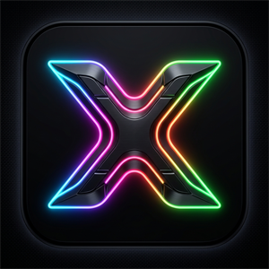

# XenRGB

<p align="center">
  
</p>

<h3 align="center">Next-Generation, Low-Power RGB Lighting Controller for Windows</h3>

<p align="center">
  <strong>Native .NET 9 & WinUI 3 &bull; Ultra-low CPU power (6–8W idle) &bull; Native JS & OpenRGB hardware support &bull; 2D Spatial Canvas &bull; Roslyn C# Effects</strong>
</p>

<p align="center">
  <a href="#key-features">Features</a> &bull;
  <a href="#why-xenrgb-power-efficiency">Power Efficiency</a> &bull;
  <a href="#hardware-support">Hardware Support</a> &bull;
  <a href="#architecture">Architecture</a> &bull;
  <a href="#building-and-running">Quick Start</a> &bull;
  <a href="#creating-custom-effects">Effect SDK</a> &bull;
  <a href="#license">License</a>
</p>

---

## What is XenRGB?

Commercial RGB software suites (SignalRGB, iCUE, Armoury Crate, Razer Synapse) are notorious for high resource usage: they run embedded Chromium instances, force the Windows timer resolution to 1 ms (`timeBeginPeriod(1)`), prevent the CPU from entering deep sleep C-states (C6/C7/C8), pin CPU clocks above 3.0 GHz, and draw 20–40 W of power even while idling on desktop.

**XenRGB** is an open-source, ultra-lightweight alternative engineered specifically for **maximum visual fidelity with minimal power consumption**. Built directly on **.NET 9** and **Windows App SDK (WinUI 3)** with zero web runtimes, XenRGB keeps modern multicore processors resting comfortably at **0.8–1.2 GHz** and **6–8 Watts** while rendering smooth 60 FPS lighting animations across all your peripherals and internal components.

---

## Key Features

- ⚡ **Ultra-Low Power Engine (6–8W Idle)**:
  - Custom kernel `WaitableTimer` frame pacer avoiding `timeBeginPeriod(1)` lockouts.
  - Windows **EcoQoS** (Efficiency Mode) applied to background animation threads.
  - Per-frame device dirty checking and throttled HID transmissions to eliminate redundant USB transfers.
  - Device watchdog keepalives prevent keyboard controllers (e.g. HyperX) from resetting to factory profiles.
- 🎮 **Native JS Plugin Engine (SignalRGB Script Support)**:
  - Built-in V8 engine (ClearScript) capable of executing native hardware JavaScript plugins directly.
  - Direct Win32 HID, USB, and memory-mapped hardware access without Electron overhead.
  - Comprehensive support for HyperX peripherals, MSI motherboards, GPUs, ARGB fan headers, and monitors.
- 🌐 **OpenRGB & WLED Integration**:
  - Built-in OpenRGB client with automated server discovery and auto-download management.
  - Automatic ARGB header resizing and channel layout calculation.
  - Real-time low-latency UDP DRGB streaming to Wi-Fi ESP8266/ESP32 WLED strips.
- 📐 **2D Spatial Canvas & Visual Editor**:
  - Drag-and-drop 2D matrix canvas to lay out keyboards, mice, fans, and LED strips in real desktop coordinates.
  - Continuous color fields flow naturally across multiple physical devices as if they were a single display.
  - Circular fan ring layouts automatically mapped for ARGB headers and liquid coolers.
- 🎨 **Roslyn-Powered Runtime C# Effects**:
  - Write custom effects in human-readable C# (`effect.cs` + `manifest.json`).
  - Hot-reloaded and compiled on the fly using the Roslyn compiler API.
- 🌙 **Display & Sleep Automation**:
  - Automatic detection of display sleep, screensaver, and system lock states.
  - **Good Night** mode for 24/7 PC operation with completely blacked-out hardware and zero CPU load.
  - Native Windows System Tray integration with quick controls and minimize-to-tray.

---

## Why XenRGB? Power Efficiency

| Metric | Commercial RGB Software (SignalRGB / iCUE) | XenRGB |
| :--- | :--- | :--- |
| **Runtime Engine** | Electron / Chromium + Node.js | Native .NET 9 + WinUI 3 (Zero Webview) |
| **Idle CPU Frequency** | Pinned at 3.0 GHz – 4.5 GHz | **0.8 GHz – 1.2 GHz** (Normal C-State Sleep) |
| **Idle Package Power** | 18 W – 35 W | **6 W – 8 W** (Hardware baseline) |
| **Timer Resolution** | Forces 1 ms system-wide interrupt | Uses High-Resolution Waitable Timers (C-State friendly) |
| **Process QoS** | Normal / High Priority | **EcoQoS Efficiency Mode** |
| **Lighting Disabled** | Continues drawing ~5–10% CPU | **0.0% CPU (Threads fully sleeping)** |

---

## Hardware Support

### 1. Direct USB HID & Native JS Plugins
- **HyperX Keyboards**: Alloy Origins, Alloy Origins 60/65, Alloy Origins Core, Alloy Elite / Elite 2, Alloy FPS RGB (Full per-key 2D matrix mapping).
- **HyperX Mice & Mats**: Pulsefire Haste (Wired & Wireless), Pulsefire Haste 2, Pulsefire Surge, Pulsefire Core, Pulsefire Dart, Pulsefire Raid, Pulsefire Mat, Fury Ultra.
- **HyperX Audio**: Quadcast S, Quadcast 2 S, Duocast, Cloud Flight.
- **MSI Motherboards**: Both 162-byte (Mystic Light) and 185-byte controllers, full ARGB 3-pin headers with circular fan ring geometry for CPU coolers and case fans.
- **MSI GPUs & Monitors**: Blackwell, Lovelace, and legacy GPU controllers; MSI MAG monitors.

### 2. OpenRGB SDK
- Seamlessly controls any device supported by OpenRGB (ASUS, Gigabyte, Corsair, Razer, Kingston, G.Skill, etc.) through the local SDK interface.
- Automatic server launch and header configuration directly inside XenRGB.

### 3. WLED (Wi-Fi)
- Network-connected addressable LED strips (WS2812B, SK6812) running WLED.
- Sub-millisecond UDP streaming via DRGB (port 21324) and HTTP JSON configuration.

---

## Solution Architecture

```text
XenRGB/
├── src/
│   ├── XenRGB.SDK/       # Pure contracts, RgbColor, Point2D, MathUtils, IEffect
│   ├── XenRGB.Core/      # Device abstractions, Spatial Canvas, Automation, WaitableTimer, EcoQoS, RgbEngine
│   ├── XenRGB.Devices/   # Native JS engine (V8), USB HID, OpenRGB client/manager, WLED provider
│   ├── XenRGB.Effects/   # Built-in effects (Cotton Candy, Rainbow, Biohazard, etc.) and Roslyn compiler
│   └── XenRGB.App/       # WinUI 3 desktop application, Visual Layout Editor, System Tray
│
├── effects/              # Drop-in scriptable C# effect packages
│   ├── CottonCandy/      # Infinite seamless ambient cloud effect
│   ├── Rainbow/          # Spectral rotating rainbow wave
│   ├── Biohazard/        # Pulsing organic bioluminescence
│   └── PlainColor/       # Solid color & brightness control
│
├── tests/
│   └── XenRGB.Tests/     # Comprehensive unit tests
│
└── docs/                 # Documentation & GitHub Pages landing site
```

---

## Prerequisites

- **Windows 10 (version 1809+) or Windows 11 (64-bit)**
- **[.NET 9 SDK](https://dotnet.microsoft.com/download/dotnet/9.0)** (version 9.0.100 or newer)

---

## Building and Running

### 1. Clone the repository
```bash
git clone https://github.com/Xenofff/XenRGB.git
cd XenRGB
```

### 2. Build the solution
```powershell
dotnet build XenRGB.sln
```

### 3. Run the application
```powershell
dotnet run --project src/XenRGB.App/XenRGB.App.csproj
```

Or execute the compiled binary directly:
```text
src\XenRGB.App\bin\Debug\net9.0-windows10.0.26100.0\win-x64\XenRGB.App.exe
```

---

## Creating Custom Effects

XenRGB features an open C# Effect SDK. Effects are standard C# scripts compiled dynamically at runtime using Microsoft Roslyn.

Create a folder in `effects/` (e.g., `effects/MyWave/`) with two files:

### `manifest.json`
```json
{
  "id": "my-wave",
  "name": "My Wave Effect",
  "author": "YourName",
  "version": "1.0.0",
  "description": "Smooth sinusoidal color wave across desktop devices",
  "parameters": [
    {
      "name": "speed",
      "displayName": "Wave Speed",
      "type": "float",
      "defaultValue": 1.5,
      "min": 0.1,
      "max": 5.0
    }
  ]
}
```

### `effect.cs`
```csharp
using System;
using XenRGB.SDK;

public class MyWaveEffect : EffectBase
{
    public override RgbColor Evaluate(Point2D position, double time)
    {
        float speed = GetFloat("speed", 1.5f);
        float wave = (MathF.Sin(position.X * 8f + (float)time * speed) + 1f) * 0.5f;
        return RgbColor.FromHsv(wave * 360f, 1.0f, 1.0f);
    }
}
```

Click **Reload Effects** in the app. Your effect will be compiled and available immediately without restarting the application!

---

## License

This project is licensed under the [MIT License](LICENSE). Free and open-source forever.
